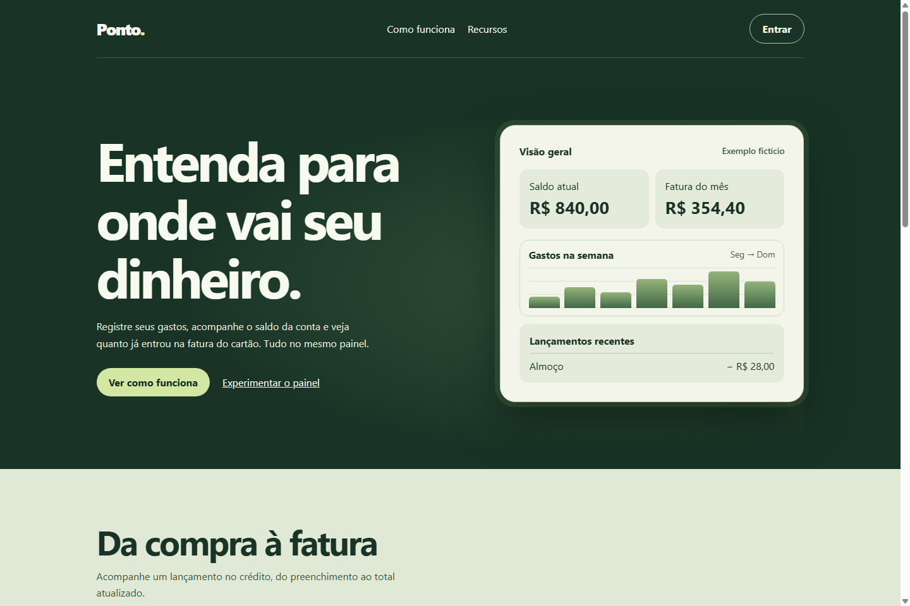
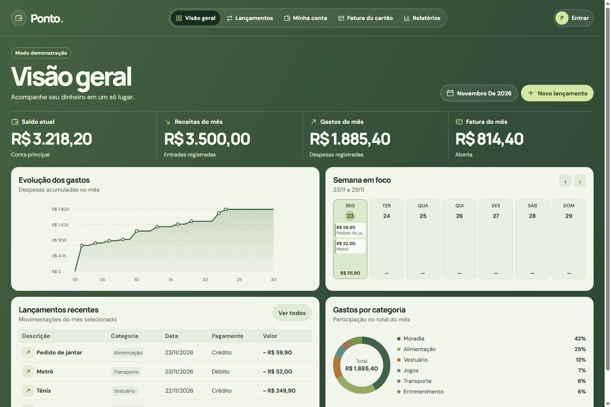
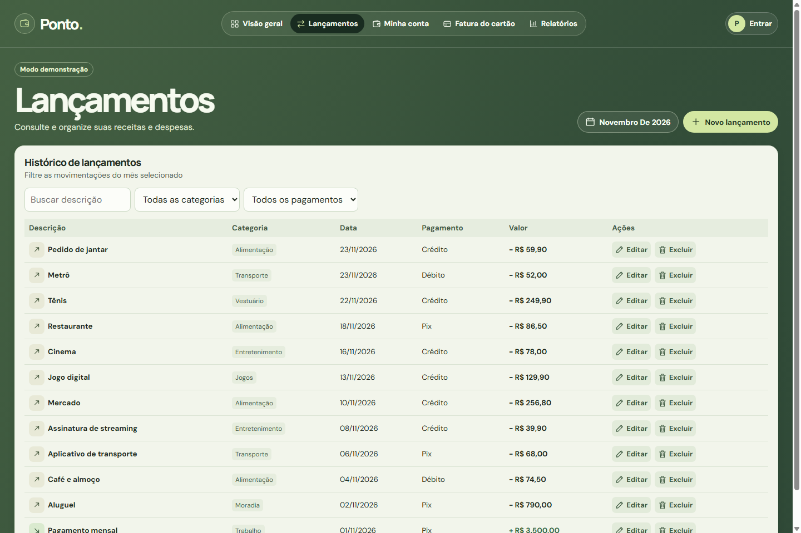

# Ponto


O Ponto é um aplicativo web de controle pessoal de gastos. Registre receitas e despesas, acompanhe seu saldo e a fatura do cartão e consulte ou imprima relatórios mensais. A demonstração pública usa dados fictícios. O piloto hospedado usa cadastro por convite.

**[Abrir o Ponto](https://ponto-4tz8.onrender.com/)** · [Arquitetura](#arquitetura) · [Tecnologias](#tecnologias)

## Telas do Ponto

### Página de entrada

A apresentação explica o produto e mostra como uma compra no crédito entra na fatura.



### Visão geral

O painel reúne saldo, receitas, despesas, fatura e a evolução dos gastos.



### Lançamentos

A lista permite filtrar movimentações e consultar a categoria, o meio de pagamento e o valor de cada registro.



## Arquitetura

```text
                     HTTPS
Navegador ──────────────────────► Render · contêiner Docker
                                   └─ Spring Boot · Java 21
                                      ├─ HTML, CSS e JavaScript
                                      └─ API HTTP · Spring MVC
                                               │
                                               │ JDBC · TLS verificado
                                               ▼
                                         Neon · PostgreSQL
```

O Spring Boot serve as páginas e a API no mesmo domínio. As páginas públicas abrem sem login. A API financeira usa a sessão para identificar a conta e restringir consultas e alterações aos seus registros.

## Tecnologias

| Camada | Tecnologias e responsabilidades |
| --- | --- |
| Front-end | HTML, CSS e JavaScript para apresentação, painel, filtros e relatórios |
| Back-end | Java 21, Spring Boot 4.1, Spring MVC, JDBC e Maven |
| Banco de dados | PostgreSQL no Neon, esquema SQL e valores monetários em `numeric` com `BigDecimal` no Java |
| Infraestrutura | Docker multi-stage, serviço web no Render e conexão JDBC com TLS verificado |
| Segurança | Cadastro por convite, senhas com PBKDF2, cookies de sessão, proteção CSRF e autorização por conta no servidor |

## Modelo de dados

| Tabela | Responsabilidade |
| --- | --- |
| `profiles` | Conta do usuário, credenciais protegidas e saldo inicial |
| `entries` | Receitas e despesas com categoria, meio de pagamento, valor e data |
| `invoice_payments` | Pagamentos das faturas por conta e mês de referência |
| `auth_rate_limits` | Controle de tentativas de autenticação e cadastro |

O esquema está em [schema.sql](https://github.com/Takazonoo/ponto/blob/main/src/main/resources/schema.sql) e as permissões do usuário da aplicação estão em [grants-hosted.sql](https://github.com/Takazonoo/ponto/blob/main/scripts/grants-hosted.sql).

## Regras desta versão

- Cada perfil tem uma conta e um cartão. O banco registra o proprietário dos lançamentos e a API usa a sessão autenticada para limitar a consulta e edição.
- O saldo é calculado com base no saldo inicial, nas movimentações à vista e nos pagamentos de fatura. Informe como saldo inicial o valor anterior ao primeiro lançamento.
- A fatura reúne as compras no crédito do mês civil. Ela fecha no último dia e vence no dia 10 do mês seguinte. O pagamento integral pode ser registrado após o fechamento. As compras de uma fatura paga ficam bloqueadas para edição.
- O servidor escuta em loopback por padrão. Em um ambiente HTTPS, configure `COOKIE_SECURE=true` e defina o endereço de escuta com `SERVER_ADDRESS` conforme a infraestrutura.
